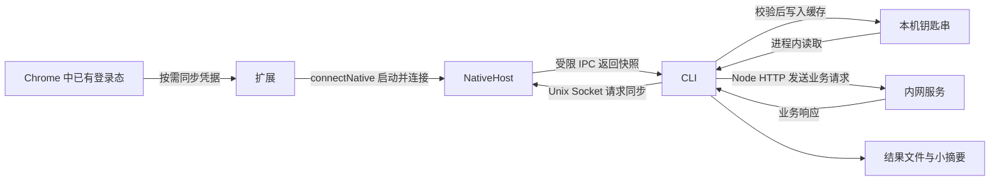

# 01 · 从零理解 Intra

> 状态：概念入门。开发版已提供源码和 CLI，构建及验证边界见[开发版状态](11-runtime-status.md)。
> 本文中的 `intra` 是命令简写，本地构建后用 `node dist/apps/cli/src/main.js` 执行；真实认证流程仍待浏览器桥安装和验收。

[返回项目首页](../README.md) · [下一篇：架构](02-architecture.md) · [完整演练](10-walkthrough.md)

## 1. 这是什么工具

假设你已经在 Chrome 登录内网站点，想让脚本读取该站点的数据。
网页能打开，并不表示脚本知道怎样证明你的身份，也不表示脚本知道业务接口地址。
Intra 把这两件事分开处理：先取得允许复用的认证信息，再按明确的接口定义发送 HTTP 请求。

浏览器只提供已有登录态。最终业务请求由本机 Node.js HTTP 客户端发送，结果主要保存成文件。
Agent 是读取命令结果并协助完成任务的程序；它只拿到摘要、文件位置和非秘密状态，不拿到 Cookie 值。

可以把整个过程想成：浏览器提供通行凭证，接口定义提供办事地址和表格，HTTP 客户端负责递交。
通行凭证不能告诉你办事地址，地址正确也不能代替通行凭证。

## 2. 要做什么，以及暂时不做什么

| 目标 | 对使用者的意义 |
| --- | --- |
| 复用 Chrome 已有登录态 | 不要求把 Cookie 手工粘贴进聊天或脚本 |
| 用本地 HTTP 客户端调用已知接口 | 不必每次打开网页并点击按钮 |
| 显式选择账号上下文 | 工作账号和其他账号不会被默认混用 |
| 本地缓存经授权同步的凭据 | 浏览器关闭后仍可尝试使用缓存，直到服务端拒绝 |
| 校验输入并返回统一结果 | 脚本能区分参数错误、登录问题、网络错误和业务失败 |
| 保存完整业务文件并给小摘要 | 大响应不需要全部进入 Agent 上下文 |

第一版不负责自动登录、验证码、绕过服务端权限或替用户完成身份验证。
它不承诺所有内网站点都兼容，也不承诺把浏览器完整网络环境复制到 Node.js。
它不自动找全未知接口，不自动遍历所有页，不把登记接口当成修改服务端。
它不依赖 o2、WebCLI、Playwright 或 jd-login 运行，也不把已有实验工具作为隐藏后端。

## 3. 先认清几个词

| 词语 | 初学者可以这样理解 |
| --- | --- |
| CLI | 在终端接收参数、执行任务并输出结果的程序 |
| Node.js | 在浏览器外运行 JavaScript 的环境，本项目用它执行本地 HTTP 请求 |
| HTTP / API | HTTP 是客户端与服务端沟通的协议；API 是服务端约定好的调用入口 |
| Cookie | 浏览器保存的一类站点状态；其中某些值能证明登录身份，应当保密 |
| Chrome 扩展 | 安装在 Chrome 中、经授权读取指定站点 Cookie 的小程序 |
| NativeHost | Chrome 可以启动的本地程序，连接扩展与本机工具 |
| Unix Socket | 同一台机器上供进程通信的本地端点，不是远程网站的端口 |
| IPC | 进程间通信；扩展、宿主和 CLI 互相传递结构化消息的方式 |
| Service | 一个站点的配置：基础地址、允许访问的来源和认证规则 |
| Operation | 一次具体业务操作的定义：参数、请求及成功判断 |
| Schema | 用来检查 JSON 结构和字段类型的机器可读规则 |
| credentialRef | 进程内凭据会话的标识，不含 Cookie 值，也不能由外部调用者凭此读取秘密 |
| Artifact | 保存到磁盘的结果文件；命令只需返回它的位置和完整性信息 |

HTTP 返回 `200` 只说明 HTTP 层成功交付响应，业务仍可能失败。
例如已验证的DevCloud探针在未认证时可以返回 HTTP `200` 和业务码 `304`。
因此每个操作需要单独说明怎样判断业务成功。raw `request` 没有操作成功规则，其 `ok=true` 只表示响应已接收并保存，`data.businessSuccess` 明确为 `unknown`。

## 4. 浏览器参与到哪一步



文字等价解释：Chrome 扩展启动宿主；CLI 通过本地 Socket 请求同步，收到宿主转发的快照后校验并写入缓存。
随后 CLI 从缓存取用凭据，并直接向内网服务发送请求。浏览器不代发业务请求。
图中的“凭据流动”不表示将 Cookie 打印到终端；秘密只在受限通信、钥匙串和进程内部出现。

这里有两个不同的启动方向：扩展调用 `chrome.runtime.connectNative`，Chrome 据此启动宿主；
CLI 连接宿主已经监听的 Socket。CLI 不能靠打开 Socket 反向唤起扩展。

## 5. Profile 与 storeId 为什么要分开

Chrome Profile 是用户看到的浏览器个人资料，例如用于工作的那一份配置。
扩展为实际 Profile 生成独立随机 ID，CLI 再显式配对友好别名；账号身份由站点探针另行核对。
示例中的 `work` 只是用户选择的别名，不能因为窗口标题像工作账号就自动认领。

`storeId` 是 Chrome Cookie API 使用的 Cookie 存储区编号。
一个 Profile 可能涉及普通、无痕等不同存储区；不同 Profile 中的编号也可能相同。
所以不能把 `storeId` 当成全局唯一的 Profile ID，更不能只凭它决定使用哪个账号。

选择顺序是：先确定 Profile 和账号绑定，再确定该连接允许读取的存储区，最后按请求 URL 选择 Cookie。
账号不明确时应报告需要选择或重新配对，不能猜一个可用账号继续。
具体身份校验见[凭据与账号隔离](06-credentials.md)。

## 6. 路径一：已经同步过，正常使用缓存

这是日常请求的常见路径；前提是目标 Profile 已配对，而且本地存在该站点的可用缓存。

1. 选择已登记的 Operation 和 Profile 别名。
2. CLI 校验参数、目标地址、操作语义和输出位置。
3. 凭据模块从钥匙串读取缓存，在进程内按目标 URL 选择 Cookie。
4. Node.js HTTP 客户端发送请求，按操作定义判断 HTTP 和业务结果。
5. 输出模块保存业务响应，并返回一个 JSON 摘要。

此时浏览器可以关闭，CLI 无需依靠仍在运行的 NativeHost 才能读取本地缓存。
缓存存在不等于会话一定有效：服务端可能已经注销、吊销或更新会话，只有实际检查才能确认。

以下是开发版命令；先登记服务和操作、完成配对和同步。此例采用已有定义的 `page` 参数，输出父目录需已存在。

```bash
intra call risk-api.auto-interfaces.list --profile work --args-json '{"page":1,"pageSize":20}' --output ./result.json
```

预期输入是操作 ID、账号上下文、JSON 参数和文件路径。
预期输出是成功状态、服务/操作标识、HTTP 状态、耗时，以及结果文件的路径、字节数和完整性。
它不应输出 Cookie、Authorization 头或钥匙串中的秘密。
没有要求翻页时只调用当前页，不把“本次调用成功”解释成“已经拿到全部数据”。

## 7. 路径二：第一次使用，需要先同步

扩展脚本、宿主和生成工具已有源码。构建不会自动加载扩展或注册宿主；首次准备按[宿主交付说明](../packaging/native-host/README.md)执行，真实 Chrome/Keychain 流程仍待验收。

1. 使用者在目标 Chrome Profile 中完成正常登录。
2. 使用者在扩展确认页面授予指定站点的必要权限，并通过 `connectNative` 连接宿主。
3. Chrome 启动宿主；宿主建立受限的本地 Socket 并登记实际连接身份。
4. 使用者把实际 Profile 与 `work` 等别名显式配对；账号仍待取得快照后核对。
5. CLI 请求手动同步指定服务；扩展仅读取授权范围内所需 Cookie。
6. 宿主把快照转发给 CLI；CLI 校验快照，有可信探针时先核对账号再写入钥匙串；无探针则保留未验证状态。
7. 命令只返回 Profile、Cookie 名称和状态；使用者再发起业务请求，接下来走上一节的缓存路径。

`doctor` 显示运行环境和桥连接信息，不读取 Keychain；macOS 的钥匙串状态是 `not-checked`，不表示账号已认证。

```bash
intra doctor
```

先用 `auth profiles` 查看已连接扩展，再配对别名。`PROFILE_ID`、`STORE_ID` 必须替换为真实连接值；只有一个 Store 时可省略 `--store`。同步复用已有登录态，不会自动重新登录。

```bash
intra auth profiles
intra auth pair --profile work --profile-id PROFILE_ID --store STORE_ID
intra auth sync --service risk-api --profile work
```

若宿主未连接，命令应说明缺少哪个环节，并提示打开正确 Profile、连接扩展或重新配对。
它不能声称已经自动唤起扩展，也不能默默改用另一 Profile。
当前扩展断连后需用户重新确认连接，没有自动重连。0.3.2没有内置站点预设，支持自定义域或用户显式所有HTTP/HTTPS网站授权；Agent可按用户提供的URL/方法/载荷直接调用，不要求登记接口。每次仍只读取具体URL适用Cookie，显式名称过滤可选。完整授权域持续同步和Cookie变更增量同步属于后续阶段。

## 8. 不知道接口地址时怎么办

Cookie 解决“以谁的身份调用”，接口发现解决“调用哪里、传什么、怎样识别结果”。
接口发现应从文档、源码、HAR 或已知 cURL 请求等证据建立草稿，再审核并验证。
HAR 是浏览器导出的网络请求记录；它可能包含秘密，导入前需要控制字段和保存范围。
当前 `api import --file PATH` 接受人工整理的 JSON，返回草稿及缺口报告，不自动登记。HAR/cURL 自动解析和限定站点、时间的请求观察仍未实现。

截图上的业务名称通常不足以确定 HTTP 方法、路径和请求体。
现有 `getPageInterIdList` 只有截图，仍为草稿，不能拿另一个已验证接口的请求来冒充。
`chrome.webRequest` 能观察部分网络事件，但不会直接提供响应体。
需要响应体时，必须单独评估 DevTools 或调试协议等采集方式。
详见[请求发现](05-request-discovery.md)。

## 9. 现有证据能支持哪些结论

先前 WebCLI 实验验证了三个服务的特定请求：risk-api 的分页接口、LogWatch 的身份接口、DevCloud的身份接口。
这些证据说明：在拿到适用凭据后，直接 HTTP 调用可以成功。
它们不能证明新项目已经能安装、能自动续期，也不能证明任意同域站点都兼容。

其中 risk-api 的查询使用 POST，说明“读取数据”不能只按 GET/POST 判断。
原始请求默认语义未知，不自动重试；只有审核为读取的操作，才允许在确认认证失效后最多刷新并重试一次。
出现 `403` 要区分权限不足和认证失败；写请求结果不明时应停止并报告，避免重复写入。
证据与限制集中记录在[证据与决策](09-evidence-and-decisions.md)。

## 10. 接下来读哪篇

- 想看各进程怎样连接：读[架构](02-architecture.md)。
- 想开始开发并找到代码归属：读[模块与目录](03-modules-and-layout.md)。
- 想核对字段、消息和退出码：读[规格契约](04-contracts.md)。
- 想处理 Cookie、账号及缓存：读[凭据](06-credentials.md)。
- 想理解失败、重试和文件输出：读[HTTP 与结果](07-http-and-results.md)。
- 想知道做到什么才算可用：读[构建与验收](08-build-and-acceptance.md)。
- 想按一次完整任务理解输入输出：读[演练](10-walkthrough.md)。
