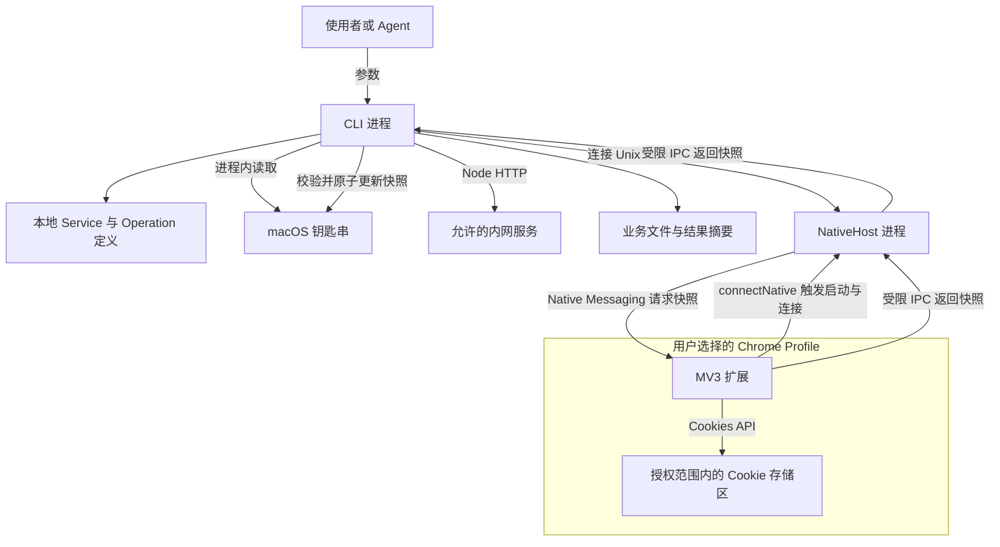
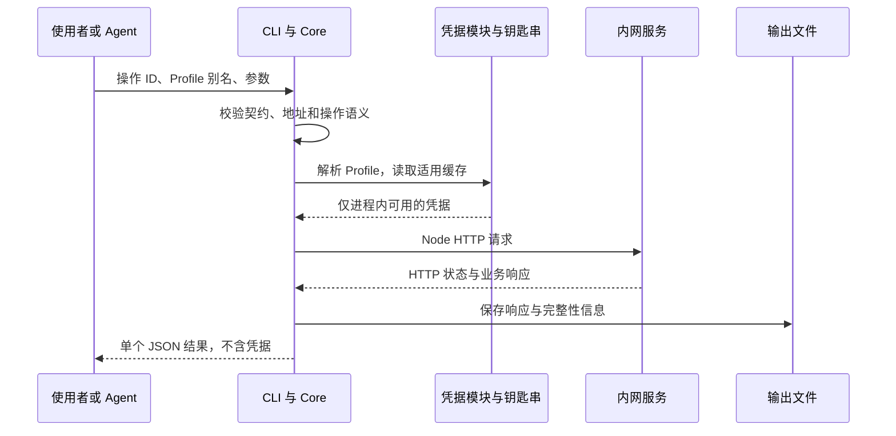
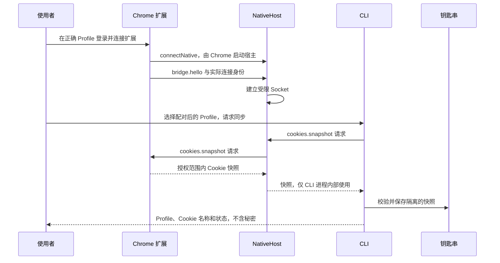

# 02 · 架构：浏览器提供凭据，本地执行请求

> 状态：开发版架构。第一版面向 macOS、Chrome Manifest V3 和 Node.js 22 及以上。
> 已有源码实现；合成测试与真实环境验收分别记录，见[开发版状态](11-runtime-status.md)。

[返回首页](../README.md) · [入门指南](01-beginner-guide.md) · [模块与目录](03-modules-and-layout.md)

MV3 是 Chrome 扩展的第三版规范；MVP 指首个最小可用版本，本文用它表示第一阶段实现范围。

## 1. 架构解决什么问题

系统要把三个动作接起来：确认请求内容、取得正确账号的认证、发送请求并保存结果。
三者分别由接口定义、本地凭据模块和 HTTP 模块负责，浏览器只参与凭据来源这一环。
接口未知时先走发现和登记；拿到 Cookie 不会让未知的业务接口自动变成已知。

第一版不引入远程凭据服务，不用网页脚本代发业务请求，不依赖 o2、WebCLI、Playwright 或 jd-login。
已有 WebCLI 实验只是设计依据；它没有提供新项目的安装、宿主通信或缓存实现。

## 2. 进程与数据所在的位置

文字等价解释：CLI 在本地读取接口定义和钥匙串，通过 Node HTTP 访问服务，把业务响应保存到文件。
需要同步凭据时，扩展先通过 Chrome 启动宿主，CLI 再连接宿主的 Socket。
宿主经已有 Native Messaging 连接向扩展请求快照，转发给 CLI，由 CLI 校验并更新钥匙串。
业务响应不经过扩展，Cookie 值也不进入 Agent 的结果摘要。

“原子替换”指一次更新要么整体可见，要么仍保留旧版本，不能让读取者拿到半份快照。
完整授权域持续同步尚属后续阶段，但第一版手动同步通过不可变快照和活动指针更新，避免读取半份状态。

## 3. 必须准确理解的启动方向

真实的启动与连接关系是：`CLI → Unix Socket → NativeHost ← Chrome connectNative`。
这条表达式中的箭头表示主动连接方向；后续请求和响应可以沿已建立连接双向传递。

1. 扩展调用 `chrome.runtime.connectNative(hostName)`。
2. Chrome 查找已注册且允许该扩展访问的 Native Messaging 宿主清单，并启动对应程序。
3. 宿主接收握手，建立实际 Profile 身份关联，开始监听受限 Unix Socket。
4. CLI 找到所选 Profile 对应的端点，校验连接与协议后发起请求。
5. 宿主沿 Native Messaging 连接请求 Cookie 快照，再向 CLI 返回受约束结果。

CLI 创建连接失败，不能靠启动一个同名普通进程获得 Chrome 扩展连接。
已有扩展与宿主产物生成工具；系统注册和 Chrome 加载仍需使用者单独完成，尚无真实环境验收。
Native Messaging 使用标准输入和标准输出传输带长度前缀的 JSON；宿主日志必须走标准错误。
Unix Socket 同样使用长度前缀 JSON 帧，单帧限制256 KiB；它不是 HTTP 服务。

Chrome 关闭、扩展重新加载或通信端口断开时，宿主可能退出，旧 Socket 也可能失效。
当前扩展不会自动重连，用户需在确认页面重新连接；CLI 检查可发现的活动端点并报告连接错误。
实现不能假设这个进程永久常驻，也不能把一次配对当成永不失效的授权。

## 4. 两条运行路径

### 4.1 正常缓存请求

文字等价解释：CLI 校验输入后直接从本地缓存取用凭据，再发送 HTTP 请求并保存响应。
这条路径不要求 Chrome 或宿主在线，前提是账号绑定和可用缓存已经存在。
缓存过期或被服务端撤销时，不能假定关掉浏览器以后还能自动获得新凭据。

### 4.2 首次或手动同步

文字等价解释：使用者先在 Chrome 登录；扩展启动并连接宿主，宿主开放本地连接端点。
CLI 指定已配对 Profile 发起同步；宿主转发快照，CLI 校验后写入钥匙串，最终向使用者只返回安全元数据。
第一次配对还需要身份核对；图中省略的账号确认细节以[凭据文档](06-credentials.md)为准。
之后发起业务请求时，回到正常缓存路径。

## 5. Profile、存储区与账号绑定

| 标识 | 表示什么 | 不能替代什么 |
| --- | --- | --- |
| `profileId` | 项目给实际 Profile 分配的独立随机 ID | 不能只从目录名或窗口标题猜出 |
| Profile 别名 | 使用者选择的友好名称，例如 `work` | 不能直接证明当前账号身份 |
| `storeId` | 当前 Chrome 连接中的 Cookie 存储区 | 不是全局唯一 Profile 标识 |
| 账号绑定 | 经身份探针确认的站点身份关联 | 不能仅从 Cookie 名称推断 |
| `credentialRef` | 绑定当前进程、Profile、账号与目标的短生命周期引用 | 不是可跨进程任意取密的访问凭据 |

随机 ID、别名和账号应显式配对；重装扩展、复制配置或发生身份变化时需要重新核对。
普通与无痕存储区不得隐式合并，某一连接中的 `storeId` 也不得用于选择另一连接的账号。
站点缺少可信身份探针时，应明确身份核对的限制，而不是把“有 Cookie”报告成“账号已确认”。

## 6. 跨边界的协议

公共契约使用 JSON Schema draft-2020-12，各格式携带 `schemaVersion: 1`。
`requestId` 用来对应某次请求与响应；未知版本、未知方法和非法字段必须按契约拒绝。
完整字段和示例由[规格契约](04-contracts.md)负责，本文只说明边界。

| 边界 | 消息用途 | 暴露范围 |
| --- | --- | --- |
| CLI → 本地包 | 校验配置、读取缓存、构造及执行请求 | 同一 CLI 进程内部 |
| CLI → NativeHost | 握手、请求限定范围的 Cookie 同步 | 受限本地 Socket |
| NativeHost ↔ 扩展 | `bridge.hello`、`cookies.snapshot` | 已授权 Native Messaging 连接 |
| CLI → 使用者 / Agent | `tool-result` 成功或失败封装 | 不含凭据的标准输出 |

IPC 中的 `http.execute` 仅为未来 CLI → 宿主通道预留，MVP 不启用，不能转发给扩展。
扩展只接受其允许的握手和快照方法；未来 `cookies.changed` 增量事件不属于第一版。
扩展返回 Cookie 的 IPC 响应不是 Agent 的 `tool-result`，不能直接透传为命令输出。

## 7. 凭据与请求边界

宿主核对扩展来源与握手；CLI 检查元数据、Socket 与所在目录的所有者和权限，目录0700，元数据和Socket为0600。标准 Node 在 macOS 上没有可用的 `SO_PEERCRED` 接口，当前没有完整的对端 UID 握手验证。
这些约束用于防止错误连接和越界读取，不表示能抵御已经控制当前操作系统账号的恶意程序。
日志、异常、遥测和结果摘要都不允许包含 Cookie 值或认证头。

Cookie 必须按最终请求 URL 匹配域、路径、过期和 Secure 等条件，站点可以进一步指定最小名称集合。
名称相同不表示作用域相同，不能把整个浏览器 Cookie 仓库拼成一个请求头。
第一版遇到分区 Cookie 应拒绝并返回 `PARTITIONED_COOKIE_UNSUPPORTED`，不降级为普通 Cookie。
同样不能宣称 Node 请求与浏览器 SameSite 上下文完全等价。

Origin 是“协议、主机和端口”的组合；目标和每一跳重定向都要重新检查允许的 Origin 与凭据适用性。
Cookie 和 Authorization 不能盲目转发到另一个 Origin，Secure Cookie 不能发往 HTTP。快照缓存按 Origin 隔离；跨 Origin 跳转重新读取目标的独立缓存，缺失就停止，不在跳转途中自动向浏览器取 Cookie。
DevCloud已有 HTTP 探针只允许其精确 Origin 例外；新登记的站点不得继承这一例外。
详细规则见[凭据](06-credentials.md)和[HTTP 与结果](07-http-and-results.md)。

## 8. 请求语义、失败与结果

`semantics` 描述业务是否只读，不通过 HTTP 方法猜测；POST 也可能是读取操作。
原始请求默认为 `unknown` 且不重试；只有审核为 `read` 的操作，确认认证失效后才允许最多刷新一次并重试一次。
MVP 刷新仍需要已连接的正确 Profile；浏览器不可用时报告需要手动连接或同步。
`403` 先按身份探针和站点规则区分认证与授权，不笼统当作 Cookie 过期。
写操作在超时或断连后可能已经生效，应返回 `REQUEST_OUTCOME_UNKNOWN`，不能自动重复提交。

命令标准输出只包含一个 JSON 结果，标准错误输出诊断信息；凭据秘密两处都不能出现。
已登记操作分别判断 HTTP 与业务成功；成功结果和错误结果互斥。raw 没有业务成功契约，`ok=true` 仅表示传输接收成功，`data.businessSuccess` 为 `unknown`。
原始业务响应按任务保存到文件，默认摘要采用字段白名单，避免响应中的令牌字段进入上下文。
超过预算要返回 `complete=false`，不能截断后伪装成完整 JSON，也不默认自动翻页。

## 9. 阶段与验收边界

| 阶段 | 计划能力 | 当前状态 |
| --- | --- | --- |
| 文档与契约 | 设计、契约、示例、模块边界 | 已有文档和离线检查 |
| 开发版MVP | 显式配对、手动快照、钥匙串适配、本地 HTTP、文件输出 | 已有源码和合成测试；真实 Chrome/Keychain/企业环境待验收 |
| 后续同步 | 完整授权域快照、变更序列、删除事件、重连校准 | 未实现 |
| 后续发现 | 限站点限时间的网络观察、独立响应体采集选择 | 未实现 |

“构建成功”“宿主能连接”“接口认证成功”“业务结果正确”是不同验收层次。
具体检查与交付门槛见[构建与验收](08-build-and-acceptance.md)，历史实验范围见[证据与决策](09-evidence-and-decisions.md)。
