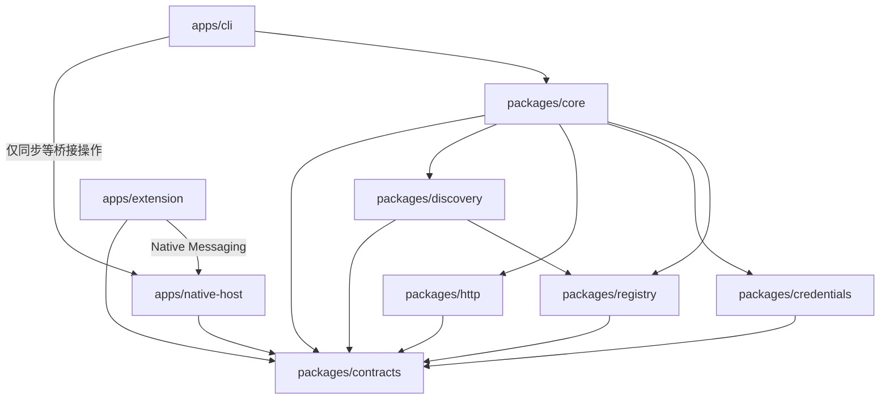

# 03 · 模块与目录：开发版源码导航

> 状态：模块职责与最初的接口设计。开发版采用 TypeScript / ESM，目标 Node.js 22 及以上。
> 各模块已有源码实现；实际导出以源码为准，验证状态见[开发版状态](11-runtime-status.md)。

[返回首页](../README.md) · [架构](02-architecture.md) · [规格契约](04-contracts.md) · [构建与验收](08-build-and-acceptance.md)

## 1. 怎样读这份目录

`apps` 放独立启动的程序；`packages` 放可以被这些程序共同调用的模块。
TypeScript 是带类型检查的 JavaScript；ESM 是用 `import` / `export` 组织代码的标准模块格式。
模块是按职责组织的代码，不意味着每个模块都需要单独启动或提供网络服务。
CLI 可以在同一进程中调用凭据与 HTTP 模块，浏览器关闭后也能读取已同步缓存。

`schemas` 定义数据长什么样；`examples` 给出符合这些规则的输入示例；`tests` 验证实际行为。
文档和示例说明契约，源码说明实现；本地合成测试与真实环境验收分别记录，不能互相替代。

## 2. 目录总览

下面列出当前源码、测试与生成工具。TypeScript 构建到 `dist`；生成开发产物不等于已经安装到系统或完成真实认证。

```text
intra/
├── README.md                    项目入口与交付状态
├── docs/                        初学者文档、设计基线和开发约定
├── apps/
│   ├── cli/                     src/main.ts：终端入口与参数适配
│   ├── extension/               background/bridge/popup 脚本、清单模板与生成工具
│   └── native-host/             src/：Chrome 宿主、本地 Socket、协议与客户端
├── packages/
│   ├── contracts/               src/：类型、AJV 2020-12 校验、公共错误
│   ├── core/                    src/：用例编排、身份探针和有界恢复
│   ├── credentials/             src/ 与 native/：配对、tough-cookie、Security助手
│   ├── http/                    src/：请求发送、分类、流式文件输出
│   ├── registry/                src/：Service / Operation 登记与参数绑定
│   └── discovery/               src/：JSON 草稿导入与缺口报告
├── schemas/                     JSON Schema 契约文件
├── examples/
│   ├── services/                站点配置示例
│   ├── operations/              操作定义示例
│   └── messages/                IPC 与工具结果示例
├── evidence/                    无凭据的实验事实与决策依据
├── tests/
│   ├── *.test.ts                合成运行时测试
│   └── fixtures/                无秘密的合成响应
├── packaging/
│   └── native-host/             宿主清单模板、启动器生成工具；不自动安装
└── tools/                       已有零依赖文档/契约检查器
```

Node.js >=22 下运行 `npm ci`、`npm run build`、`npm test`，CLI 入口为 `node dist/apps/cli/src/main.js`，文中简称 `intra`。`npm run check:docs` 保持零依赖。扩展清单和宿主启动器需显式生成并由使用者加载/注册；当前验证证据见[开发版状态](11-runtime-status.md)。

## 3. 模块依赖方向



文字等价解释：CLI 把用户输入交给 Core；Core 按用例调用登记、凭据、HTTP 或发现模块。
扩展通过 Native Messaging 连接宿主；宿主转发快照，CLI 调用凭据模块校验并保存。
公共契约位于依赖底层，各模块依它校验数据；契约包不能反过来启动浏览器或执行 HTTP。
图中的扩展→Contracts 表示遵守共享协议；扩展实际使用自包含 JavaScript 检查，不直接导入 Node/AJV，宿主与客户端再独立校验消息。

## 4. 三个应用分别负责什么

| 应用 | 输入与输出 | 负责 | 不承担 |
| --- | --- | --- | --- |
| CLI | 命令参数 → 单个 JSON 结果、退出码 | 参数解析、调用 Core、诊断输出 | 网页自动化、输出秘密 |
| Chrome 扩展 | 授权快照请求 → Cookie IPC 响应 | `connectNative`、权限确认、Cookie API | 业务 HTTP、未知接口自动发现 |
| NativeHost | Native Messaging / Socket 消息 → 受约束响应 | 握手、连接路由、快照同步 | 默认永久常驻、替 Agent 输出 Cookie |

扩展是宿主连接的发起者：Chrome 根据 `connectNative` 启动宿主，然后 CLI 连接其 Unix Socket。
不能把三者写成“CLI 启动宿主，宿主再自动拉起扩展”。
宿主 stdout 专用于 Native Messaging 帧，CLI stdout 专用于一个 `tool-result`；两者的日志都走 stderr。
浏览器或端口断开后宿主可能退出，正常缓存请求仍由 CLI 进程直接读取钥匙串并执行 HTTP。
`http.execute` 仅为未来 CLI → 宿主协议预留，MVP 不实现，更不能交给扩展执行。

## 5. 六个共享模块的边界

| 模块 | 核心职责 | 主要输入 | 主要输出 |
| --- | --- | --- | --- |
| contracts | 定义版本、类型、校验与错误结构 | 未校验 JSON | 已校验对象或结构化错误 |
| registry | 管理本地站点和操作定义 | 配置文件、操作 ID | Service、Operation、来源信息 |
| discovery | 从证据建立可审核草稿 | 人工整理的文档或定义文件；HAR/cURL 可作依据 | `draft` 操作与证据缺口 |
| credentials | 配对、快照存取、适用 Cookie 选择 | Profile、服务、URL、受限快照 | 公共引用或仅进程内的秘密 |
| http | 发送、超时、重定向、响应判断、文件输出 | 已解析请求与内部凭据提供器 | 结果、文件信息或结构化错误 |
| core | 按用例协调策略与模块 | 用户意图、参数、已登记操作 | 面向 CLI 的统一结果 |

Registry 的“登记”只修改本地定义，不调用服务端创建业务接口。
Discovery 提供证据和草稿，不凭名称补出未知方法、路径或请求体，也不自动把草稿升级为已验证。
Core 决定是否允许认证刷新和重试；HTTP 模块不能绕过操作语义自行重发写请求。
Credentials 负责秘密边界；Registry 和 Discovery 不应持有真实凭据。

## 6. 内部接口职责示意

下表是模块职责示意，名字和形参不保证与源码导出逐字相同，也不是稳定公共 API；实际实现以各模块源码为准。
正式消息字段以[规格契约](04-contracts.md)为准，内部类型应由公共契约派生或显式映射。

| 接口草案 | 输入 → 输出 | 必须保留的约束 |
| --- | --- | --- |
| `contracts.validate(kind, value)` | 格式类型、JSON → 校验对象 | 拒绝不支持的 `schemaVersion` |
| `registry.register(definition)` | 定义 → 本地登记结果 | 校验来源与状态，不执行业务请求 |
| `registry.resolve(operationId, args)` | 操作 ID、参数 → 服务、组装后的请求、语义与响应规则 | 草稿不得直接执行 |
| `discovery.import(source)` | 文件证据 → 草稿和缺口 | 无证据字段保持未知 |
| `credentials.pair(connection, alias)` | 实际连接、别名 → 配对记录 | 随机 Profile ID 与账号显式关联 |
| `credentials.resolve(profileId, accountId, url, cookieNames)` | 身份、URL、名称 → credentialRef 和元数据 | 引用绑定当前调用进程，不输出秘密 |
| `browser.snapshot(profileId, storeId, url, cookieNames, deadlineMs)` | 限定范围 → Cookie 快照 | 仅受限内部传递，由 CLI 校验并落库 |
| `http.execute(materializedRequest, credentialRef, context)` | 请求、凭据引用、上下文 → 状态、bodyRef、字节数和耗时 | 每一跳重新检查 Origin 与凭据 |
| `response.classify(rawResponse, responseRules, authRules)` | 响应与规则 → 成功或失败分类 | HTTP 200 不直接等于业务成功 |
| `output.persist(bodyRef, target, budget, policy)` | 响应引用与输出策略 → Artifact、摘要、完整性 | 原样保存业务内容，报告完整性 |
| `core.call(intent)` | 调用意图 → ToolResult | 统筹校验、语义、刷新次数与错误映射 |

`browser.snapshot` 是 Credentials 调用桥接适配器的边界，`response` 与 `output` 是 HTTP 包内的职责分区。
`credentialRef` 是当前进程中的受限引用；跨进程应重新解析，不能把它当作通用凭据或持久化秘密。
内部 `http.execute` 函数与同名预留 IPC 方法属于不同层：MVP 使用前者，不启用后者。
HTTP 通过内部上下文按 URL 重新取得适用凭据，不接收可任意转发的全站 Cookie 字符串。

## 7. 一次请求在代码中怎样流动

1. CLI 解析参数，构造用例输入，拒绝未知选项和格式错误。
2. Core 从 Registry 取出 Service 与 Operation，并用 Contracts 校验参数。
3. Core 通过 JSON Pointer 映射参数；保留数字、布尔等类型，不执行字符串模板代码。
4. Credentials 解析 Profile 及账号绑定，并从钥匙串读取缓存。
5. HTTP 按允许的 Origin、URL 与 Cookie 规则发送请求，控制超时与重定向。
6. Core 根据 HTTP 状态和操作定义中的业务成功条件作判断。
7. HTTP 输出部分保存原始业务响应；Core 只挑选允许的摘要字段。
8. CLI 输出一个 ToolResult，并使用约定退出码结束。

JSON Pointer 是用路径定位 JSON 字段的标准写法；例如 `/data/listResult` 指向嵌套字段。
路径存在不表示结果类型正确，输入映射和响应提取都应做类型或结构检查。
失败分支不能绕过公共输出约定；认证错误、业务错误和写入结果未知应保留区别。
首次同步的进程流转详见[架构](02-architecture.md)，这里不把桥接逻辑混入每次 HTTP 调用。

## 8. 共享类型与错误归谁维护

Contracts 是 Service、Operation、IPC、ToolResult 公共类型和 Schema 版本的归属位置。
Registry 负责加载这些定义，不能另写一套不一致的校验规则。
IPC 与工具结果即使都使用 JSON，也必须有独立校验入口，防止 Cookie 响应误当作 Agent 输出。

各模块产生包含错误码和安全消息的内部错误，Core 映射到统一错误封装，CLI 映射退出码。
原始异常可能含 URL、认证头或响应片段，不能未经处理直接写入 stderr。
`PARTITIONED_COOKIE_UNSUPPORTED`、`REQUEST_OUTCOME_UNKNOWN` 等行为须由契约和验收同时覆盖。
完整错误码、退出码、成功失败互斥关系见[规格契约](04-contracts.md)。

## 9. 实现与验收的分层

| 次序 | 完成内容 | 可检查的结果 |
| --- | --- | --- |
| 1 | Contracts 与本地 Registry | 示例通过 Schema；无效输入被拒绝 |
| 2 | Discovery 文件导入 | 未知接口保留草稿与缺口，不编造请求 |
| 3 | Core、HTTP 和输出骨架 | 用本地模拟服务验证响应、超时、预算与错误 |
| 4 | Credentials 钥匙串与配对 | 合成凭据隔离、删除、引用和过期匹配正确 |
| 5 | 扩展、宿主、Socket | 正向启动、断连重连和快照同步可测试 |
| 6 | 缓存路径与真实站点验收 | 浏览器关闭仍可用缓存；实际认证结果有记录 |

前五层已有开发版源码和合成测试；表中涉及真实 Chrome、Keychain 和企业站点的环节仍需单独验收。具体覆盖见[开发版状态](11-runtime-status.md)，不能把测试替身的通过写成真实环境通过。
增量变更、完整授权域持续同步与浏览器请求观察放在后续阶段，不占用 MVP 的已完成状态。

## 10. 各种改动应该放哪里

- 新增站点或接口定义：先确认[请求发现](05-request-discovery.md)中的证据要求，再进入 Registry 与示例。
- 调整 Profile、Cookie 匹配或缓存：修改 Credentials，并同步[凭据说明](06-credentials.md)。
- 调整超时、重定向、文件预算或重试：修改 HTTP / Core，并同步[HTTP 与结果](07-http-and-results.md)。
- 调整消息、输出字段或版本：先修改 Contracts / Schema，并更新[规格契约](04-contracts.md)。
- 调整宿主部署与交付：进入 Packaging，并更新[构建与验收](08-build-and-acceptance.md)。
- 增加实验结论：记录到[证据与决策](09-evidence-and-decisions.md)，区分历史实验与当前实现验证。

当前 CLI 命令见[规格契约](04-contracts.md)，使用步骤见[入门指南](01-beginner-guide.md)和[演练](10-walkthrough.md)。源码可构建不等于已完成全局安装、Chrome 接入或线上调用验收。
