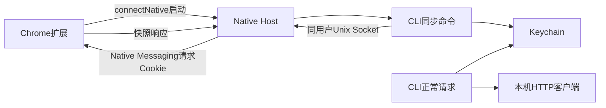

# 06 · 凭据管理与自有浏览器桥

本章解释怎样“拿到浏览器已经有的身份”。身份签发、登录页面和MFA仍由企业系统负责；读取Cookie不能产生新的登录权限。当前已有开发版实现；测试范围和真实 Keychain/Chrome 待验收项见[开发版状态](11-runtime-status.md)。

## 一、为什么能读取HttpOnly

Chrome扩展声明cookies权限，并取得请求站点和Cookie自身所属域的host permission后，可以使用`chrome.cookies.getAll({url,storeId})`读取适用于该URL的Cookie，包括HttpOnly。HttpOnly限制页面JavaScript读取，不禁止获授权扩展通过Cookies API读取。

`getAll` 不只检查传入URL：Chrome还按每个Cookie的所属域与Secure属性对应协议过滤权限。因此只授权子域可能漏掉父域共享登录Cookie。扩展0.3.2没有内置预设，只接受用户输入的自定义域；每个明确域都申请HTTP/HTTPS的根域及子域权限，以覆盖非Secure和Secure Cookie。用户也可主动勾选全部HTTP/HTTPS网站，默认关闭，仍须Chrome权限确认。每次快照始终指定具体URL和Store，不省略URL读取全库。依据见[Chromium Cookie权限过滤实现](https://raw.githubusercontent.com/chromium/chromium/main/extensions/browser/api/cookies/cookies_helpers.cc)。

这不需要打开目标网站标签页，也不需要开发者工具。浏览器必须运行、正确Profile的扩展必须连接。不会直接解密浏览器Cookie数据库，也不会把document.cookie当通用来源。

[扩展manifest模板](../apps/extension/manifest.template.json)已配套[后台脚本](../apps/extension/background.js)、[桥控制器](../apps/extension/bridge.js)和[确认页面](../apps/extension/popup.html)。用户在确认页面输入自定义域或显式选择全部网站授权，Chrome确认后扩展连接宿主。0.3.0不再硬编码业务站点，Agent可把用户明确的URL/方法/载荷交给 `request --url`；工具不发现接口或推断业务参数。扩展每次同时检查当前选择与实际权限，之前的宽授权不会绕过本次只选一个域的限制。

## 二、进程启动方向



文字解释：扩展先连接并启动Native Host，CLI才能通过宿主向扩展请求Cookie。CLI不能直接调用chrome.cookies，也不能凭空唤醒未启动的浏览器。普通业务请求在CLI进程中读Keychain并发HTTP，所以不依赖宿主持续在线。

Native Host随Chrome连接可能退出；它清理自己持有的Socket和元数据，不盲删猜测的旧路径。当前扩展不会自动重连，Chrome/worker/端口重启后需要用户重新确认连接。CLI检查元数据、Socket和目录的所有者与权限；macOS标准Node没有可用的SO_PEERCRED接口，不能宣称完整的对端UID握手认证。需要长期服务时再独立设计daemon生命周期。

## 三、Profile、Store、账号分别是什么

| 名称 | 例子 | 含义 |
|---|---|---|
| Profile | work | 用户选择的浏览器资料目录，扩展为实例生成随机ID，再显式绑定友好别名 |
| Cookie Store | 0 | Chrome返回的Cookie存储标识；不是稳定的跨Profile身份 |
| 业务账号 | 用户ERP | 服务器确认的身份，不从普通展示性Cookie里猜 |
| 认证家族 | sso / uas | 凭据用途分组，不意味着可互换 |

不同Profile可以拥有相同storeId。快照按profileId、storeId、serviceId和origin隔离，已验证accountId参与不可变快照记录；没有身份探针时标记account-unverified，不能悄悄合并到另一账号。

扩展的随机profileId不是密码或强身份；首次配对必须由用户在扩展UI确认，宿主记录extensionId与profileId关联。复制Profile可能复制本地ID，检测同时在线冲突后拒绝并重新配对，不能随机挑一个连接。

无痕模式第一版不启用；后续必须独立获得授权、独立Store和生命周期，不与常规Profile混用。

## 四、按需快照：MVP的同步方式

1. CLI resolve缓存；如果缺失或显式sync，发cookies.snapshot。
2. 请求包含profileId、storeId、目标URL和deadline，cookieNames过滤器可选。
3. CLI核对配对与端点权限；宿主校验Profile/Store与站点范围，不声称已通过操作系统peer UID验证。
4. 扩展再次校验域权限，按URL读取Cookie并过滤所需名称。
5. 返回完整Cookie属性、snapshotId和observedAt。
6. CLI验证响应与请求对应、属性合法；有可信探针时先核对账号，再以不可变快照和活动指针发布到Keychain。
7. 对Agent只输出Cookie名称和状态，不输出value。

示例消息在 [快照请求](../examples/messages/snapshot-request.json) 与 [快照响应](../examples/messages/snapshot-response.json)。后者含合成值，不是可用凭据。

## 五、通用Cookie支持如何扩展

每次只同步具体URL的快照。省略cookieNames时取所有适用Cookie，显式名称列表进一步筛选且必须齐全；空数组非法，URL模式无适用Cookie时返回COOKIE_NOT_FOUND。自动URL缓存带完整模式标记，只复用相同Origin和pathname，query变化可复用；不同路径需浏览器新快照。旧的按名称筛选缓存不能当完整快照。授权范围再大也不把所有网站Cookie拼成一个header；匹配仍考虑hostOnly/domain/path/secure/expiry，同名不同路径分别保留。

第一版使用tough-cookie CookieJar实现普通Cookie匹配，不手写字符串域后缀判断。例如corp.example不匹配evilcorp.example，/api不匹配/apix。Secure Cookie绝不通过HTTP发送。Cookie domain更广不代表工具的allowedOrigins更广。

SameSite/分区Cookie与浏览器的顶层站点上下文有关。原生HTTP客户端不自动具备该上下文；v1遇到所需分区Cookie返回PARTITIONED_COOKIE_UNSUPPORTED，不删除partitionKey后重放，不声称完全模拟浏览器。

### 后续增量同步（尚未实现）

- 初始快照必须带epoch/序号；快照期间缓存变化事件，再按顺序应用。
- chrome.cookies.onChanged处理新增、覆盖、过期、显式删除；覆盖可能是删除加新增，不当成永久退出。
- 删除事件必须删除对应缓存，不能留下长期可用的旧值。
- 重连全量校准，避免丢事件造成缓存比浏览器“更长寿”。
- Keychain提交必须原子；快照过大时分页协议需要整体提交点，不以半份数据覆盖旧快照。
- 浏览器关闭后无法得知后续删除/撤销，因此缓存状态是last-observed，服务端响应才是最终有效性证据。

## 六、保存与使用

macOS Keychain存秘密，普通配置文件只保存服务定义、Profile别名和非秘密状态。Keychain原生助手调用Security.framework，通过受控子进程的私有stdin/stdout传递请求和秘密；秘密不进入argv、shell历史或CLI输出。首次实际访问需要可用的macOS原生编译工具链构建助手，普通TypeScript构建和doctor不会访问Keychain。助手不可用、钥匙串锁定或拒绝访问返回KEYCHAIN_UNAVAILABLE（exit7），不降级成明文文件。真实Keychain行为仍需验收。

没有明确Cookie过期时间时，会话元数据的expiresAt为null。它不等于“永不过期”，也不是所有CLI结果的固定字段。凭据已知过期就不发送；未到浏览器expiry也可能被服务端撤销。浏览器关闭后，只要缓存仍被服务端接受，就能继续业务请求；无法离线凭空刷新登录。

Set-Cookie只更新当前调用的HTTP会话，不反写Chrome，也不跨调用持久化。generation用于识别浏览器快照变化；跨调用HTTP更新与浏览器快照的冲突规则尚未实现。旧不可变快照为并发读取暂留Keychain，目前没有自动垃圾回收。跨origin重定向重新读取目标的独立缓存；缺失就停止，不在重定向途中自动同步浏览器。

内部credentialRef只是当前进程会话的标识，没有面向外部调用者的按ID取密入口。Agent不应保存它并期待在另一进程中解析。

## 七、认证恢复

```text
成功 → 正常返回
明确认证失效 → 标记缓存generation失效 → 单飞同步一次
    新凭据且操作允许重放 → 重试一次
    未变化/浏览器也失效 → LOGIN_REQUIRED
业务403且身份探针成功 → FORBIDDEN
没有可靠探针 → AUTH_STATE_UNDETERMINED
网络错误 → 网络分类，不重登
```

单飞按Profile、Store、账号上下文和服务范围加锁，其他进程有界等待并重新读取generation；等待超时返回REFRESH_LOCK_TIMEOUT（exit7），不无限阻塞。锁文件只存pid/generation等元数据，不存凭据。

## 八、首次安装与外部依赖

需要Chrome、自有扩展、Node和本地宿主注册。Native Host manifest指定**可执行启动器的绝对路径**，不是任意JS文件或带空格的一整串命令。启动器必须使用已确定的Node路径，Chrome启动环境不保证继承终端PATH。

已有[Native Host模板](../packaging/native-host/manifest.template.json)和[启动器生成工具](../packaging/native-host/generate.mjs)，使用者须填入真实extensionId与安装路径，按[交付说明](../packaging/native-host/README.md)生成并审阅。工具不自动系统注册、安装扩展或启动Chrome。o2、WebCLI、Playwright、jd-login不进入依赖树。

API依据：[Chrome Cookies API](https://developer.chrome.com/docs/extensions/reference/api/cookies)、[Native Messaging](https://developer.chrome.com/docs/extensions/develop/concepts/native-messaging)、[扩展权限](https://developer.chrome.com/docs/extensions/develop/concepts/declare-permissions)。实现时再次核对目标Chrome版本。
